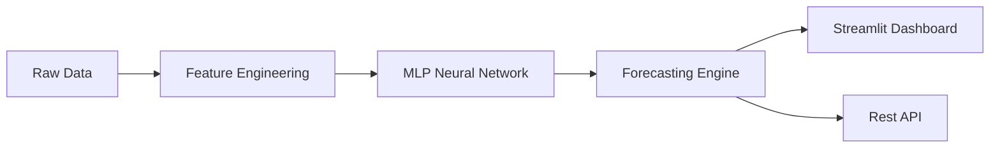
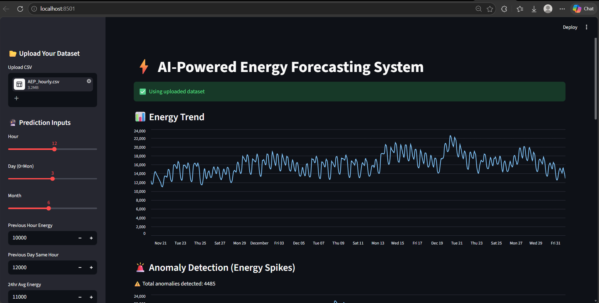
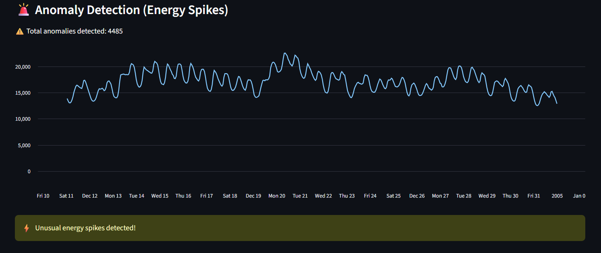
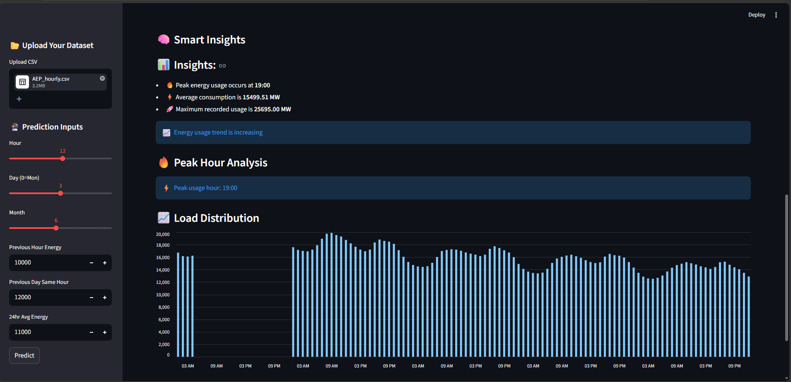
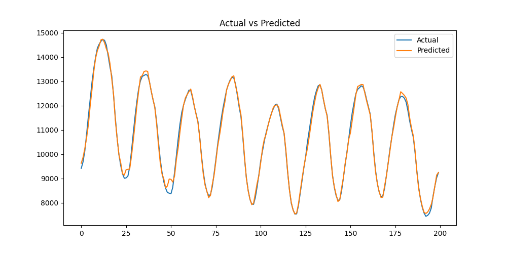

# ⚡ AI-Powered Energy Consumption Forecasting System

[](https://www.python.org/)
[](https://scikit-learn.org/)
[](https://streamlit.io/)
[](https://opensource.org/licenses/MIT)

> **Predicting future electricity demand using Neural Networks and Time-Series Analysis to power the Smart Cities of tomorrow.**

---

## 🧠 Project Overview
This project is an **end-to-end AI system** designed to forecast energy consumption patterns. By leveraging **MLP Regressors (Neural Networks)** and sophisticated **Time-Series Feature Engineering**, the system provides actionable insights for power grid optimization and sustainable energy management.

### 💡 The Solution
* **Predictive Modeling:** Anticipates peak loads to prevent grid failure.
* **Cost Efficiency:** Helps industries optimize operational hours based on energy forecasts.
* **Sustainability:** Facilitates better integration of renewable energy sources by understanding demand curves.

---

## 🛠️ Tech Stack

| Category | Tools |
| :--- | :--- |
| **Core AI** | Python, Scikit-Learn (MLP Regressor), NumPy |
| **Data Processing** | Pandas, Time-Series Lagging, Rolling Statistics |
| **Visualization** | Matplotlib, Seaborn |
| **Deployment** | Streamlit (Interactive Dashboard), Flask (Rest API) |

---

## 🏗️ System Architecture



### 🚀 Key Features🔮 
Advanced Forecasting: Uses Lag Features ($Lag_1$, $Lag_{24}$) to capture hourly and daily seasonality.
📊 Interactive Dashboard: Real-time "What-If" analysis for energy managers.
🚨 Anomaly Detection: Identifies unusual consumption spikes (potential leaks or equipment failure).
🧠 Smart Insights: Automated detection of peak usage hours and statistical trends.
📈 Visual InsightsEnergy Forecasting TrendAnomaly DetectionActual vs Predicted Energy (Neural Network)Identifying consumption spikes

## 📸 Dashboard & Insights Preview

### ⚡ Real-Time Demand Forecasting

*Interactive Streamlit interface allowing users to adjust parameters and view instant AI-generated energy predictions.*

### 🚨 Intelligence Anomaly Detection

*Automated identification of consumption irregularities, highlighting potential energy leaks or equipment malfunctions.*

### 🧠 Smart Usage Analytics

*Deep-dive analytics showing peak consumption hours, weekend vs. weekday trends, and model confidence intervals.*

### 📉 Accuracy Validation

*Comparison of Ground Truth vs. MLP Neural Network predictions, demonstrating the model's ability to capture complex non-linear patterns.*

### 🖥️ Dashboard Preview
Interactive Streamlit Interface for Real-Time Prediction

### 📂 Project StructurePlaintextAI-Energy-Forecasting/
``` text
├── data/               # Synthetic & Real-world datasets
├── models/             # Serialized (.pkl) ML models
├── outputs/            # Generated analytical plots
├── src/                # Modular Source Code
│   ├── preprocess.py   # Data cleaning logic
│   ├── feature_eng.py  # Lag & Rolling features
│   └── model.py        # Neural Network architecture
├── main.py             # Training & Evaluation pipeline
└── app.py              # Streamlit Web Application

```

### ⚙️ Installation & Usage

1️⃣ Setup EnvironmentBashgit clone 
cd AI-Energy-Forecasting
python -m venv venv
source venv/bin/activate  # On Windows: venv\Scripts\activate
pip install -r requirements.txt

2️⃣ Run the PipelineBash# Generate data and train the model
python main.py

# Launch the interactive dashboard
streamlit run app.py

### 👩‍💻 About the Developer
Shravani Mane CSE-AIML Student 

I build AI solutions that bridge the gap between complex data and real-world impact. Developed with ❤️ for Sustainable Engineering.    